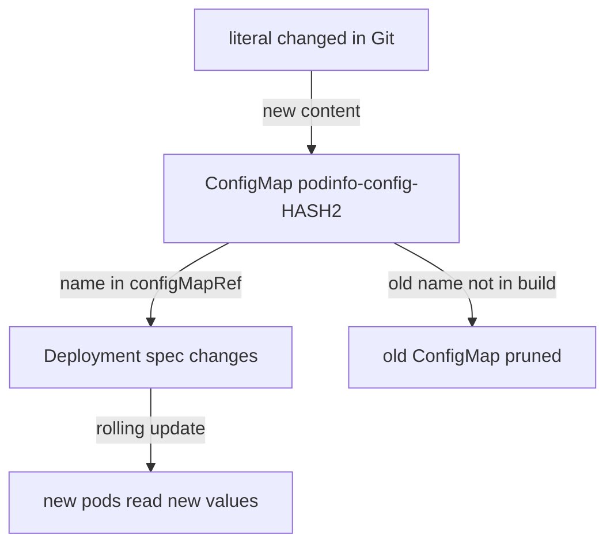

# Generators And Hash Suffixes

A Deployment reads its configuration from a ConfigMap or a Secret. When the data in that object changes, the Deployment does not know, because the Deployment object itself is identical. Kubernetes does not restart the pods when a ConfigMap changes, so the pods keep the old values until someone restarts them. This part shows how Kustomize generators make the Deployment change whenever the data changes, and what that looks like in a Flux `Kustomization`.

## The problem with a plain ConfigMap

Look at the staging overlay in your clone. It lists `configmap.yaml`, a ConfigMap with the fixed name `podinfo-config`. Suppose you change the message in that file and push. Flux applies the new ConfigMap, and the cluster holds the new data. The pods of the Deployment `podinfo` keep running, and they read their environment variables only when a container starts. The Deployment spec did not change, so Kubernetes has no reason to roll out new pods.

The usual fix outside Flux is a manual `kubectl rollout restart`. In a GitOps repository that is a manual step that Git does not record, and it is easy to forget. Kustomize removes the step with generators.

## What a generator does

A **generator** is a field of the Kustomize file that creates a Kubernetes object from values in the file, instead of from a manifest you write. `configMapGenerator` creates ConfigMaps and `secretGenerator` creates Secrets. Both take `literals` (`KEY=value` lines) and `files` (the content of a file), and Secrets can also set a `type`.

By default, a generator adds a **hash suffix** to the name: a short string computed from the content. Kustomize also rewrites every reference in the build to the new name, such as the `configMapRef` of a Deployment. When the data changes, the hash changes, so the name changes, and so the Deployment spec changes too. A changed Deployment spec makes Kubernetes roll out new pods that read the new ConfigMap.



The diagram shows the chain: new content gives a new name, a new name changes the Deployment, and the Flux `Kustomization` prunes the old ConfigMap because it is no longer in the build.

## Generate a ConfigMap and a Secret

Change the staging overlay in your clone. Replace the content of `apps/podinfo/overlays/staging/kustomization.yaml` and remove the plain ConfigMap file from the list.

<!-- astrona:playground:renew -->

```yaml
apiVersion: kustomize.config.k8s.io/v1beta1
kind: Kustomization
namespace: podinfo-staging
resources:
  - ../../base
configMapGenerator:
  - name: podinfo-config
    literals:
      - PODINFO_UI_MESSAGE=generated
secretGenerator:
  - name: podinfo-token
    literals:
      - token=lab-only-value
```

Build it:

```sh
kubectl kustomize apps/podinfo/overlays/staging
```

The output has a ConfigMap whose name is `podinfo-config-` followed by a hash, a Secret whose name is `podinfo-token-` followed by a hash, and the Deployment, whose `configMapRef` now carries the same hashed ConfigMap name. Nothing refers to the Secret yet, so its name appears only on the Secret.

The Secret generator stores `token` as base64 data. Base64 is an encoding, not encryption, so anyone who can read the file or the Secret reads the value. A real repository never keeps a plain secret literal in Git. SOPS encryption, which kustomize-controller can decrypt, is the way to keep secrets in Git.

## Watch Flux roll the pods

Commit and push the change, and let the Flux `Kustomization` `podinfo-staging` apply it:

```sh
git add apps/podinfo/overlays/staging/kustomization.yaml
git commit -m "Generate the ConfigMap and a Secret"
git push origin main
flux reconcile source git fleet
flux reconcile kustomization podinfo-staging
```

Then check the result:

```sh
kubectl -n podinfo-staging get configmap,secret
kubectl -n podinfo-staging get pods
kubectl -n gitea exec deploy/tester -- sh -c 'curl -s http://podinfo.podinfo-staging:9898 | jq -r .message'
```

The namespace holds one ConfigMap and one Secret, each with a hashed name. The plain `podinfo-config` is gone: it was in the inventory of the Flux `Kustomization` and no longer in the build, so pruning removed it. The pods list shows a new pod, and the old one terminates once the new one is ready. The request answers `generated`.

Now change the literal to `generated-again` in the file, commit, push and reconcile as before. This time, run `kubectl -n podinfo-staging get configmap` right after the reconcile. The ConfigMap has a new hash, the Deployment rolled again, and the previous ConfigMap is pruned. No one ran a restart command: the name carried the change.

## Options and when to turn the hash off

The generator takes `options`. `disableNameSuffixHash: true` keeps the plain name. Then the Deployment does not change when the data changes, and you are back to the problem at the top of the page. Use it only when something outside Kustomize must find the object by a fixed name, and accept that pods need a manual restart.

`behavior` controls what a generator does when an object with that name already comes from a base: `create` (the default), `replace` and `merge`. A common use is a base that generates a ConfigMap with defaults and an overlay that merges its own keys on top.

You now know why a generator rolls pods, what the hash does, and what Flux does with the old object. The open question is reuse: many overlays need the same small change, such as resource limits. Copying it into every overlay brings back the copies this module started with. Components solve that.

## Common pitfalls

> [!WARNING]
> - **Keeping the plain ConfigMap file in `resources` next to the generator.** The build then has the plain ConfigMap and the generated one, and the pods may read the one that never changes.
> - **Writing a literal as `KEY: value`.** Literals use `KEY=value`.
> - **Putting a secret value in a generator in Git.** The Secret is base64, not encrypted. Anyone with read access to the repository reads it.
> - **Turning the hash off and expecting a rollout.** With `disableNameSuffixHash: true` the name never changes, so the pods do not roll.

## Your mission: Roll Pods With A Generated ConfigMap

You can now turn a plain ConfigMap into a generated one so that a message change rolls the pods. The graded lab gives you a staging overlay that a Flux `Kustomization` already applies with a plain ConfigMap, and asks you to change it in Git so that the new message `rolled-out` reaches the pods without a restart command.

The lab runs in its own cluster, so first pause your playground. Nothing in it is lost:

```sh
astrona stop ats-096-playground-010-02
```

Then start the lab:

```sh
astrona run --git ssh://git@github.com/astrona-io/ATS096.git -c sections/section-010/module-02/labs/lab-01
```

The task is on the next page. Solve it on your own first. When you think you are done, send it for grading:

```sh
astrona submit -c sections/section-010/module-02/labs/lab-01
```

When the lab is done, remove it and start your playground again:

```sh
astrona destroy ats-096-lab-010-02
astrona start ats-096-playground-010-02
```
