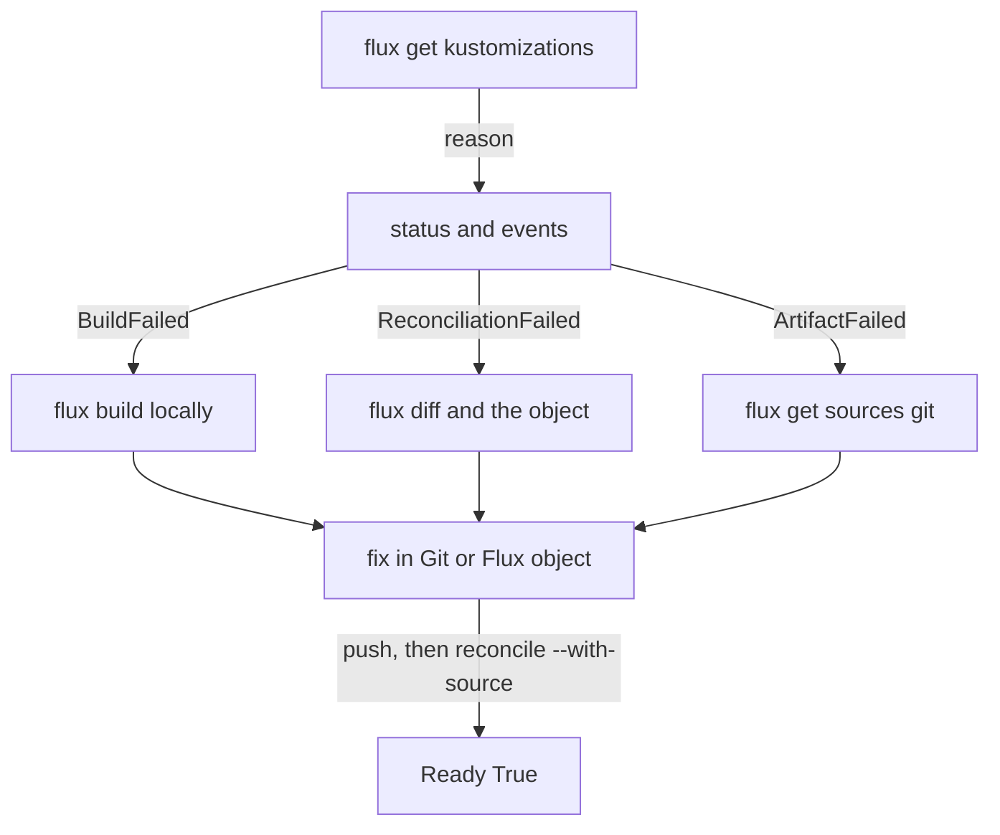

# Trace And Debug Workflow

Until now you started from a Flux `Kustomization` and looked at what it did. In daily work you often start the other way around. You see a Deployment that behaves strangely, and you ask which Flux object created it, from which Git repository and at which commit. This part shows three ways to walk back from a live object, and it ends with a fixed order of checks that you can use on any failing Flux `Kustomization`.

## Start from the live object

Make sure `podinfo-staging` from the playground exists and is `Ready`. Then ask Flux to trace the Deployment:

<!-- astrona:playground:renew -->

```sh
flux trace podinfo --kind deployment --api-version apps/v1 --namespace podinfo-staging
```

The command reads the labels that kustomize-controller puts on every object it applies and follows them back. It prints the object, then the Flux `Kustomization` that applied it with its path, then the `GitRepository` with its URL, branch and the revision it last fetched, and for each step the status and the time of the last reconciliation. One command answers three questions: who applies this object, from where, and at which commit.

The labels it follows are `kustomize.toolkit.fluxcd.io/name` and `kustomize.toolkit.fluxcd.io/namespace`. You can read them yourself:

```sh
kubectl -n podinfo-staging get deployment podinfo --show-labels
```

The labels name the Flux `Kustomization` `podinfo-staging` in `flux-system`. If an object has no such labels, Flux did not apply it, and `flux trace` says so. That is a quick way to find objects that someone created by hand.

## Read the inventory

The Flux `Kustomization` also keeps a list of everything it applied. Print it:

```sh
kubectl -n flux-system get kustomization podinfo-staging -o jsonpath='{range .status.inventory.entries[*]}{.id}{"\n"}{end}'
```

Each line is an object id built from the namespace, name, group and kind joined with underscores, for example the Deployment and the Service of `podinfo`. This list is what pruning uses: an object that is in the inventory and no longer in the build is deleted. It is also a check for a claim such as "Flux manages this object". If the id is not in the list, this Flux `Kustomization` does not own the object.

When an object is missing from the cluster but you expect it, compare two things: the output of `flux build kustomization`, which says what the build contains, and the inventory, which says what was applied. A difference between them shows the step where the object got lost.

## See which field manager changed a field

The API server records which client owns each field of an object, because kustomize-controller uses server-side apply. The record is the list of managed fields. A field manager is the name under which a client applied fields, such as `kustomize-controller`. Print them for the Deployment:

```sh
kubectl -n podinfo-staging get deployment podinfo --show-managed-fields -o yaml
```

The entries under `metadata.managedFields` list each manager, the operation, the time, and the fields it owns. You see `kustomize-controller` as the owner of the fields from Git. If someone ran `kubectl scale` or `kubectl edit`, another manager appears with the fields it changed. When a value in the cluster differs from Git, this tells you who changed it. The next reconciliation applies the value from Git again and takes the field back.

## A fixed order of checks

When a Flux `Kustomization` is not `Ready`, go through the same steps every time. The order moves from the cheapest check to the most detailed one, and each step has a question that decides the next.



The diagram shows that the reason picks the next check, and that every fix ends with a reconcile that fetches the source first.

1. Run `flux get kustomizations` and read `READY`, `SUSPENDED` and the message. A suspended object does nothing until it is resumed.
2. Read the reason and message with `kubectl get kustomization -o yaml` or `flux events`.
3. If the reason is about the source (`ArtifactFailed`), run `flux get sources git` and check that the `GitRepository` is `Ready` and has the revision you expect.
4. If the reason is `BuildFailed`, clone the repository at the same revision and run `flux build kustomization` or `kubectl kustomize` on the same path.
5. If the reason is `ReconciliationFailed`, run `flux diff kustomization` and read the log of kustomize-controller for the object the API server refused.
6. After the fix, push, then run `flux reconcile kustomization <name> --with-source` and read `READY` again.

Add one question at every step: is this the revision I think it is? Compare `status.lastAttemptedRevision` with the commit in Git. Many "the fix does not work" reports are a fix that was never fetched.

You now have a route from a symptom to a cause: trace the live object, read the inventory and the field managers, and follow a fixed order of checks. A failing build is no longer a mystery but a list of steps, each with a command that shows it.

## Common pitfalls

> [!WARNING]
> - **Tracing an object Flux does not own.** `flux trace` needs the Flux labels. An object created with `kubectl apply` has none.
> - **Reading the inventory as "what is in the cluster".** It is what this Flux `Kustomization` applied. Other objects in the namespace can come from elsewhere.
> - **Fixing a field by hand and expecting it to stay.** Flux applies the value from Git again at the next reconciliation.
> - **Skipping step 1.** A suspended object shows no error. It simply does nothing.
