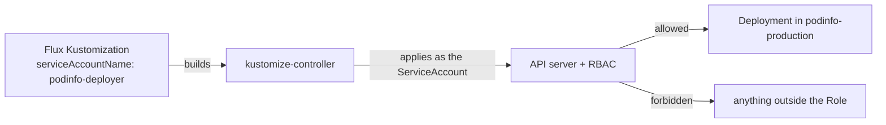

# Impersonate A Service Account

By default, kustomize-controller applies objects with its own account, which has cluster administrator rights. Whatever a Flux `Kustomization` builds, the controller can create, change and delete anywhere in the cluster. When one team's folder in Git can reach another team's namespace, or a mistake in a path can delete a cluster-wide object, that power is too much. The field `serviceAccountName` limits it.

## What impersonation does

When a Flux `Kustomization` sets `spec.serviceAccountName`, kustomize-controller still reads the source and builds the manifests with its own account, but it applies, waits for and prunes the objects **as that ServiceAccount**. The ServiceAccount must be in the same namespace as the Flux `Kustomization`. Kubernetes RBAC then decides what the apply may do, exactly as for any other client.



An administrator can make this the rule. The controller flag `--default-service-account` sets the account for every Flux `Kustomization` that names none, and `--no-cross-namespace-refs` blocks references to sources in other namespaces. These flags belong to the controller installation, not to the Flux `Kustomization`.

## Prepare a folder to deploy

Save these three files in your clone of the repository, in a new folder `apps/podinfo-limited`. The first is the Kustomize file:

```yaml
apiVersion: kustomize.config.k8s.io/v1beta1
kind: Kustomization
resources:
  - deployment.yaml
  - service.yaml
```

The second is `deployment.yaml`. It sets the message in plain text, because this part is not about secrets:

```yaml
apiVersion: apps/v1
kind: Deployment
metadata:
  name: podinfo-limited
  labels:
    app: podinfo-limited
spec:
  replicas: 1
  selector:
    matchLabels:
      app: podinfo-limited
  template:
    metadata:
      labels:
        app: podinfo-limited
    spec:
      containers:
        - name: podinfo
          image: ghcr.io/stefanprodan/podinfo:6.15.0
          env:
            - name: PODINFO_UI_MESSAGE
              value: limited
          ports:
            - name: http
              containerPort: 9898
```

The third is `service.yaml`:

```yaml
apiVersion: v1
kind: Service
metadata:
  name: podinfo-limited
spec:
  selector:
    app: podinfo-limited
  ports:
    - name: http
      port: 9898
      targetPort: http
```

<!-- astrona:playground:renew -->

Commit and push the folder:

```sh
git add apps/podinfo-limited
git commit -m "Add the podinfo-limited folder"
git push origin main
```

## Create a ServiceAccount with small permissions

Save this as `deployer-rbac.yaml`. The ServiceAccount lives in `flux-system`, next to the Flux `Kustomization`. The Role lives in the target namespace `podinfo-production` and allows the verbs a Flux apply needs, but only on Deployments:

```yaml
apiVersion: v1
kind: ServiceAccount
metadata:
  name: podinfo-deployer
  namespace: flux-system
---
apiVersion: rbac.authorization.k8s.io/v1
kind: Role
metadata:
  name: podinfo-deployer
  namespace: podinfo-production
rules:
  - apiGroups: ["apps"]
    resources: ["deployments"]
    verbs: ["get", "list", "watch", "create", "update", "patch", "delete"]
---
apiVersion: rbac.authorization.k8s.io/v1
kind: RoleBinding
metadata:
  name: podinfo-deployer
  namespace: podinfo-production
roleRef:
  apiGroup: rbac.authorization.k8s.io
  kind: Role
  name: podinfo-deployer
subjects:
  - kind: ServiceAccount
    name: podinfo-deployer
    namespace: flux-system
```

```sh
kubectl apply -f deployer-rbac.yaml
```

## Apply with the ServiceAccount

Save this as `podinfo-limited.yaml`:

```yaml
apiVersion: kustomize.toolkit.fluxcd.io/v1
kind: Kustomization
metadata:
  name: podinfo-limited
  namespace: flux-system
spec:
  interval: 10m
  path: ./apps/podinfo-limited
  prune: true
  targetNamespace: podinfo-production
  serviceAccountName: podinfo-deployer
  sourceRef:
    kind: GitRepository
    name: fleet
```

```sh
kubectl apply -f podinfo-limited.yaml
flux reconcile kustomization podinfo-limited --with-source
flux get kustomizations
kubectl -n flux-system describe kustomization podinfo-limited
```

The Flux `Kustomization` is not `Ready`. The Deployment can be applied, but the Role has no rule for Services. The status message names the failed object and says that the ServiceAccount `podinfo-deployer` is forbidden to act on Services in `podinfo-production`. That message is the proof that the apply ran as the ServiceAccount and not as the controller.

Add the missing permission. Save this as `service-rule.yaml` and apply it. It replaces the Role with a version that also covers Services:

```yaml
apiVersion: rbac.authorization.k8s.io/v1
kind: Role
metadata:
  name: podinfo-deployer
  namespace: podinfo-production
rules:
  - apiGroups: ["apps"]
    resources: ["deployments"]
    verbs: ["get", "list", "watch", "create", "update", "patch", "delete"]
  - apiGroups: [""]
    resources: ["services"]
    verbs: ["get", "list", "watch", "create", "update", "patch", "delete"]
```

```sh
kubectl apply -f service-rule.yaml
flux reconcile kustomization podinfo-limited
kubectl -n podinfo-production get deployment,service
```

The Flux `Kustomization` retries and becomes `Ready`. Both objects exist in `podinfo-production`.

## What the account must be allowed to do

Applying is not the only thing the controller does as the ServiceAccount. It also reads objects to compare them, watches them when `wait` or `healthChecks` is set, and deletes them when `prune` is true and an object leaves the build. A Role that allows only `create` and `patch` fails at the first read or the first prune. If the folder grows, the Role grows with it, and each new kind of object needs a new rule. That is the cost of least privilege and also its value: a change to a path in Git cannot touch an object the Role does not cover.

Impersonation protects the cluster from the content of the source. It does not protect the source itself. Whoever can push to the branch still decides what is built, so the Role should be as small as the folder allows.

## Common pitfalls

> [!WARNING]
> - **Creating the ServiceAccount in the wrong namespace.** `serviceAccountName` is looked up in the namespace of the Flux `Kustomization`, not in `targetNamespace`.
> - **Binding the Role in the wrong namespace.** The Role and the RoleBinding must be in the namespace where the objects are applied.
> - **Giving only write verbs.** Without `get`, `list` and `watch` the controller cannot compare, wait or prune.
> - **Giving `cluster-admin` to make the error go away.** The Flux `Kustomization` then has the same power as the controller, and the setting protects nothing.
> - **Applying the Flux `Kustomization` before the Role exists.** The first reconcile fails with a forbidden error and retries on the next interval, so the object shows `Not Ready` until the Role is in place.
