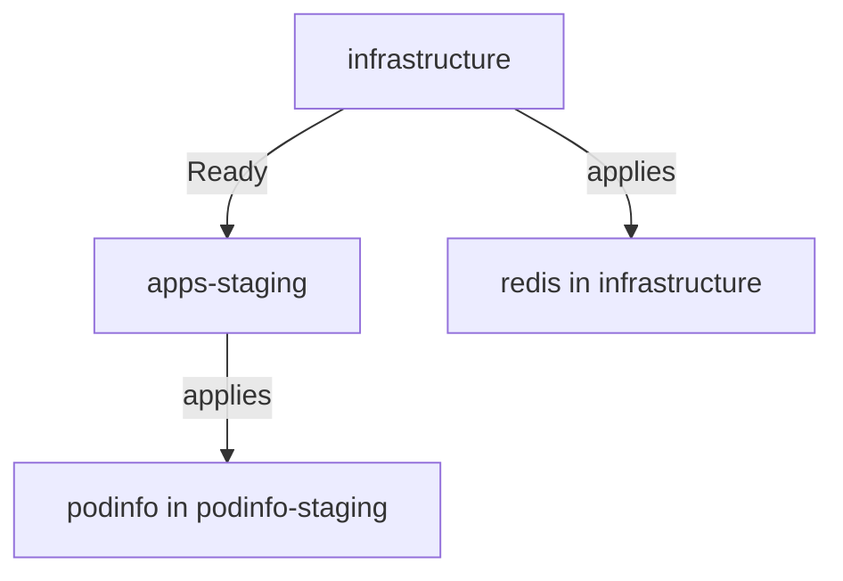

# Ordering With dependsOn

Every Flux `Kustomization` reconciles on its own schedule. kustomize-controller does not know that `podinfo` needs `redis`, so it applies both as soon as each one's turn comes. This part tells Flux about the order. You create a Flux `Kustomization` for the cache and one for the application, make the application wait for the cache, and read what a waiting object reports.

## What dependsOn does

`dependsOn` is a list in the spec of a Flux `Kustomization`. Each entry names another Flux `Kustomization`, by `name` and, when it lives elsewhere, by `namespace`. Before kustomize-controller builds and applies the folder, it checks the `Ready` condition of every named object. If one of them is not `Ready`, it applies nothing, marks this object not ready with the reason `DependencyNotReady`, and tries again after `retryInterval`.



The diagram shows the order: `apps-staging` waits until `infrastructure` is `Ready`, and only then applies `podinfo`.

`dependsOn` checks one thing only: the `Ready` condition of the other object. It does not look at `redis` itself. So what `Ready` means for `infrastructure` decides what the dependency is worth, a point the next part returns to.

## Create the application first

To see the waiting state, create the application before its dependency. Save this as `kustomization-apps-staging.yaml`:

<!-- astrona:playground:renew -->

```yaml
apiVersion: kustomize.toolkit.fluxcd.io/v1
kind: Kustomization
metadata:
  name: apps-staging
  namespace: flux-system
spec:
  interval: 10m
  retryInterval: 30s
  path: ./apps/podinfo/base
  prune: true
  wait: true
  timeout: 2m
  targetNamespace: podinfo-staging
  dependsOn:
    - name: infrastructure
  sourceRef:
    kind: GitRepository
    name: fleet
  postBuild:
    substitute:
      environment: staging
      message: staging
```

Apply it:

```sh
kubectl apply -f kustomization-apps-staging.yaml
```

Then check the result:

```sh
flux get kustomizations
kubectl -n podinfo-staging get deployment
```

The row for `apps-staging` shows `READY` as `False`, and the message says that the dependency `flux-system/infrastructure` is not ready. The object `infrastructure` does not exist at all, which counts as not ready. The namespace `podinfo-staging` is still empty: kustomize-controller applied nothing. Every 30 seconds, the value of `retryInterval`, it checks again.

## Create the dependency

Now create the Flux `Kustomization` for the cache. It applies the folder `infrastructure/redis`, which brings its own namespace, so it needs no `targetNamespace`. Save this as `kustomization-infrastructure.yaml`:

```yaml
apiVersion: kustomize.toolkit.fluxcd.io/v1
kind: Kustomization
metadata:
  name: infrastructure
  namespace: flux-system
spec:
  interval: 10m
  path: ./infrastructure/redis
  prune: true
  wait: true
  timeout: 2m
  sourceRef:
    kind: GitRepository
    name: fleet
```

Apply it:

```sh
kubectl apply -f kustomization-infrastructure.yaml
```

Then watch both objects:

```sh
flux get kustomizations --watch
```

First `infrastructure` becomes `Ready`, once the `redis` pod is running. Within the next retry interval, `apps-staging` notices, applies `podinfo`, waits for it, and becomes `Ready` too. Stop the watch with Ctrl-C. The order held even though you created the objects the wrong way round: Flux does not care about creation order, only about the `dependsOn` list.

## Rules for dependencies

A few rules keep a dependency graph working. A Flux `Kustomization` can depend on several others, and it waits until all of them are `Ready`. Dependencies can chain, as the next part of this module builds: production on staging, staging on infrastructure. They must not form a loop, because then every object waits for another forever.

A dependency in another namespace needs `namespace` in the entry. A dependency may also carry a `readyExpr`, a Common Expression Language (CEL) expression that replaces the plain `Ready` check, for example to also require a certain revision. Most pipelines never need it.

`dependsOn` orders reconciliations only. It does not order deletions, so when you remove a whole pipeline, delete the dependents first. Once `apps-staging` has applied `podinfo`, a later problem with `redis` does not remove `podinfo`; it only stops the next reconciliation of `apps-staging`.

You can now make one Flux `Kustomization` wait for another and read why it waits. The open question is whether `Ready` on `infrastructure` really means that `redis` runs. With `wait: true` it does; without it, it does not, and that is the subject of health checks.

## Common pitfalls

> [!WARNING]
> - **A typo in a dependency name.** A missing object counts as not ready, so the dependent waits forever with `DependencyNotReady`. Read the name in the message carefully.
> - **Expecting creation order to matter.** Flux ignores the order in which you apply objects. Only `dependsOn` orders them.
> - **A dependency in another namespace without `namespace`.** Flux looks for the name in the namespace of the dependent object and does not find it.
> - **A long `retryInterval` on a waiting object.** It decides how soon the dependent notices that its dependency became ready. Without it, the dependent waits a whole `interval`.
