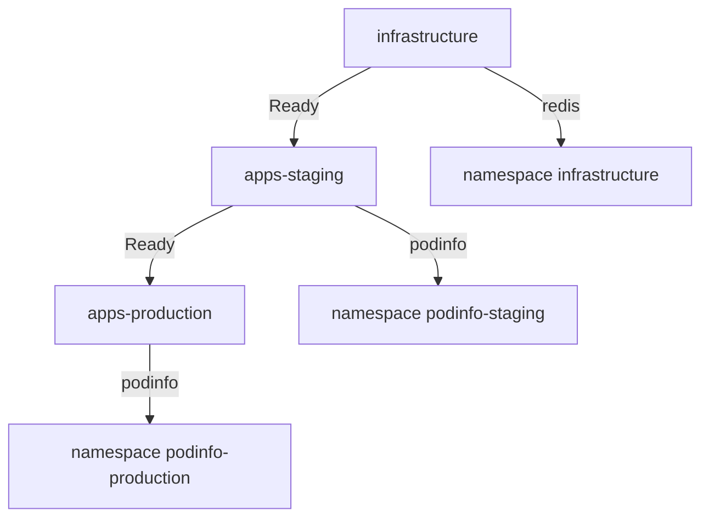

# A Staged Pipeline From Staging To Production

Staging exists so that a bad change fails there first. But staging and production read the same folder from the same branch, so a commit reaches both Flux `Kustomization` objects at the same time. This part connects them: production depends on a healthy staging. Then you push a bad commit and watch it stop in staging while production keeps serving the last good version.

## The pipeline

The pipeline has three stages, each one a Flux `Kustomization` with a health check, each one waiting for the stage before it:



The diagram shows the chain: production applies only while staging is `Ready`, and staging only while infrastructure is `Ready`.

Because every stage checks health, `Ready` on staging means that the current commit runs there. Production reads that condition before each reconciliation. A commit that breaks staging makes staging not ready, and production then refuses to apply anything at all, including that commit.

## Add the production stage

Your playground has `infrastructure` and `apps-staging`. Add production. Save this as `kustomization-apps-production.yaml`:

<!-- astrona:playground:renew -->

```yaml
apiVersion: kustomize.toolkit.fluxcd.io/v1
kind: Kustomization
metadata:
  name: apps-production
  namespace: flux-system
spec:
  interval: 10m
  retryInterval: 30s
  path: ./apps/podinfo/base
  prune: true
  wait: true
  timeout: 2m
  targetNamespace: podinfo-production
  dependsOn:
    - name: apps-staging
  sourceRef:
    kind: GitRepository
    name: fleet
  postBuild:
    substitute:
      environment: production
      message: production
```

Apply it:

```sh
kubectl apply -f kustomization-apps-production.yaml
```

Then check the result:

```sh
flux get kustomizations
```

All three stages show `READY` as `True`, with the same revision. The pipeline works for a good commit. The real test is a bad one.

## Push a bad commit

Start the port-forward to Gitea in a second terminal (`kubectl -n gitea port-forward svc/gitea-http 3000:3000`) and clone the repository, if you have not already. If `gitea.localtest.me` does not resolve, add `127.0.0.1 gitea.localtest.me` to `/etc/hosts`. In `fleet/apps/podinfo/base/deployment.yaml`, change the image tag from `6.15.0` to `0.0.0-missing`, then commit and push:

```sh
git -C fleet commit -am "Upgrade podinfo"
git -C fleet push
```

Now let staging take the commit. The reconcile waits for the health check, so it takes about two minutes and ends with an error:

```sh
flux reconcile kustomization apps-staging --with-source
```

Then ask production to reconcile, and compare the revisions:

```sh
flux reconcile kustomization apps-production
flux get kustomizations
kubectl -n gitea exec deploy/tester -- sh -c 'curl -s http://podinfo.podinfo-production:9898 | jq -r .version'
```

`apps-staging` is not ready with a failed health check. `apps-production` is not ready either, but for a different reason: its message says that the dependency `apps-staging` is not ready, and it applied nothing. Its last applied revision is still the previous commit, and podinfo in production still answers with version `6.15.0`. The bad commit stopped in staging.

## Recover with a commit

The fix for a bad commit is another commit. Revert it and push:

```sh
git -C fleet revert --no-edit HEAD
git -C fleet push
flux reconcile kustomization apps-staging --with-source
```

Staging applies the revert and becomes `Ready`. Within the next retry interval of 30 seconds, production reconciles too, sees a healthy staging, and applies the newest revision, which is the same good version it already runs. `flux get kustomizations` shows all three stages `Ready` again, on the revert commit.

This pipeline has limits worth knowing. Production waits for staging's `Ready` condition, not for a person's approval and not for a soak time; a commit that is healthy in staging reaches production at once. Teams that need a pause point production at a different branch or tag, and promote a commit by moving that reference. And a fault that only shows in production, such as a production-only value, is not caught by staging at all.

You can now build a pipeline where every stage waits for a healthy stage before it, and you have seen it stop a bad commit. That is exactly what the graded lab asks you to build from scratch.

## Common pitfalls

> [!WARNING]
> - **Production without a health check on staging.** Then staging is `Ready` as soon as its objects are stored, and the bad commit reaches production anyway.
> - **Fixing a bad commit with `kubectl`.** Flux puts the broken version back at the next reconciliation. Revert in Git.
> - **Removing `dependsOn` to get production going.** The pipeline then has no gate left. Fix staging instead.
> - **Expecting an approval step.** `dependsOn` gates on health, not on people. Use a separate branch or tag for production when you need a manual promotion.

## Your mission: Build A Staged Pipeline From Staging To Production

You can now order three stages with `dependsOn` and gate each one with a health check. The graded lab gives you a cluster with the `fleet` source and empty namespaces, and asks you to build the infrastructure, staging and production stages so that each one waits for a healthy stage before it.

The lab runs in its own cluster, so first pause your playground. Nothing in it is lost:

```sh
astrona stop ats-096-playground-020-01
```

Then start the lab:

```sh
astrona run --git ssh://git@github.com/astrona-io/ATS096.git -c sections/section-020/module-01/labs/lab-01
```

The task is on the next page. Solve it on your own first. When you think you are done, send it for grading:

```sh
astrona submit -c sections/section-020/module-01/labs/lab-01
```

When the lab is done, remove it and start your playground again:

```sh
astrona destroy ats-096-lab-020-01
astrona start ats-096-playground-020-01
```
