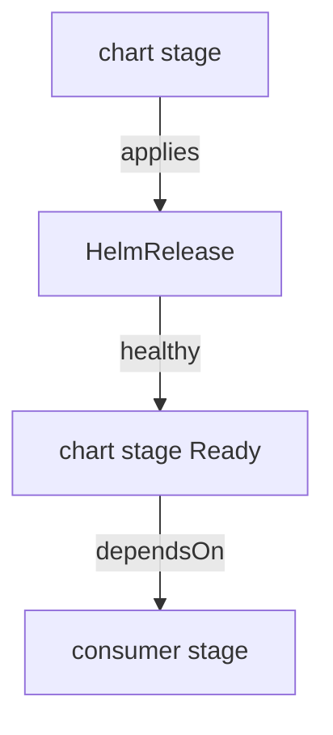

# The Problem Of Order Across Kinds

A folder in Git holds a custom resource and the definition of its kind. If Flux applies the resource before the definition exists, the API server refuses it, because it does not know the kind. This part makes that error appear on purpose, so that you can recognize it, and then explains which objects `dependsOn` can order and which it cannot.

## What fails without the definition

A custom resource definition (CRD) teaches the API server a new kind. An object of that kind can only be stored after the definition exists. Run a dry run of an object whose kind is unknown:

<!-- astrona:playground:renew -->

```sh
kubectl create namespace order-demo
```

Save this as `widget-without-crd.yaml`:

```yaml
apiVersion: demo.astrona.io/v1
kind: Widget
metadata:
  name: gauge
  namespace: order-demo
spec:
  size: 1
```

Apply it:

```sh
kubectl apply -f widget-without-crd.yaml
```

The command fails. The message says that no matches for the kind `Widget` in the version `demo.astrona.io/v1` exist, and suggests that the definition must be installed first. Flux shows the same text in the status of a Flux `Kustomization` that applies such an object too early, with the reason `ReconciliationFailed`.

## Where Flux orders for you

Inside one Flux `Kustomization`, kustomize-controller applies the objects in groups. It applies the definitions and the namespaces first, then everything else, so a folder that holds a CRD and an object of that kind works in one apply. Across two Flux `Kustomization` objects, there is no such order. Each one reconciles on its own clock.

A custom resource definition that comes from a Helm chart is a harder case. The definitions are created while helm-controller installs the release, which is later than any apply from a folder. A stage that applies objects of that kind must wait for the release.

## What dependsOn can order

`dependsOn` in a Flux `Kustomization` names other Flux `Kustomization` objects. In a `HelmRelease` it names other `HelmRelease` objects. It does not link a Flux `Kustomization` to a `HelmRelease` directly. The bridge between the kinds is the health check: a Flux `Kustomization` that applies a `HelmRelease` is `Ready` only when the release is healthy, so a second stage that depends on this stage waits for the chart.



The diagram shows the chain: the consumer stage waits for the chart stage, and the chart stage becomes `Ready` only when its `HelmRelease` is healthy.

You can now recognize the error of a missing definition and name the two orders Flux gives you: inside one folder, and between objects of the same kind. The open question is how to build the bridge for a chart, which the next part does.

## Common pitfalls

> [!WARNING]
> - **Putting a custom resource and its chart in one folder.** The definitions of a chart exist only after the release installed, so the resource fails to apply first.
> - **Expecting `dependsOn` on a Flux `Kustomization` to accept a `HelmRelease`.** It accepts Flux `Kustomization` objects only.
> - **Reading `no matches for kind` as a permission problem.** It means the definition does not exist yet.
