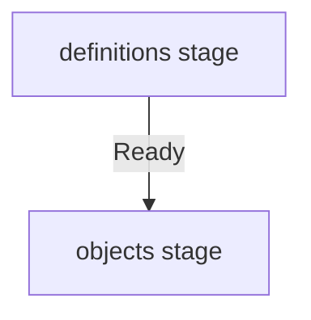

# CRDs And Their Custom Resources

Operators and controllers ship custom resource definitions, and clusters then hold many objects of those kinds. The first reconciliation of a new cluster is where order mistakes show: the objects exist in Git before the definitions exist in the cluster. This part gives the two reliable layouts, one stage for definitions and one stage for objects, and shows the difference to the single-folder case.

## The single folder case

When the definition and the object are files in the same folder, one Flux `Kustomization` is enough. kustomize-controller applies definitions and namespaces before the other objects, so the object follows its definition in the same apply. Create the folder with both files and a Kustomize file that lists them:

<!-- astrona:playground:renew -->

```sh
mkdir -p apps/widgets
```

Save this as `apps/widgets/crd-widget.yaml`:

```yaml
apiVersion: apiextensions.k8s.io/v1
kind: CustomResourceDefinition
metadata:
  name: widgets.demo.astrona.io
spec:
  group: demo.astrona.io
  scope: Namespaced
  names:
    kind: Widget
    plural: widgets
    singular: widget
  versions:
    - name: v1
      served: true
      storage: true
      schema:
        openAPIV3Schema:
          type: object
          x-kubernetes-preserve-unknown-fields: true
```

Save this as `apps/widgets/widget.yaml`:

```yaml
apiVersion: demo.astrona.io/v1
kind: Widget
metadata:
  name: gauge
spec:
  size: 1
```

Save this as `apps/widgets/kustomization.yaml`, then commit and push the folder:

```yaml
apiVersion: kustomize.config.k8s.io/v1beta1
kind: Kustomization
resources:
  - crd-widget.yaml
  - widget.yaml
```

```sh
git add apps/widgets
git commit -m "Add the widget and its definition"
git push origin main
```

Save this as `kustomization-widgets.yaml`:

```yaml
apiVersion: kustomize.toolkit.fluxcd.io/v1
kind: Kustomization
metadata:
  name: widgets
  namespace: flux-system
spec:
  interval: 10m
  path: ./apps/widgets
  prune: true
  wait: true
  timeout: 2m
  targetNamespace: podinfo-staging
  sourceRef:
    kind: GitRepository
    name: fleet
```

Apply it and check the result:

```sh
kubectl apply -f kustomization-widgets.yaml
flux get kustomizations
kubectl -n podinfo-staging get widget gauge
```

The stage becomes `Ready` and the Widget exists. kustomize-controller applied the definition before the Widget inside the same apply.

## The two stage layout

Definitions that come from a chart, or from a folder owned by another team, need two stages. The first stage applies the definitions and is gated with `wait: true`. The second stage applies the objects and depends on the first:



The diagram shows that the objects stage starts only after the definitions stage is ready. The first stage is ready when the definitions are established, so by the time the second stage applies the objects, the API server knows the kind.

Write the second stage with `dependsOn` on the first:

```yaml
apiVersion: kustomize.toolkit.fluxcd.io/v1
kind: Kustomization
metadata:
  name: widget-objects
  namespace: flux-system
spec:
  interval: 10m
  retryInterval: 1m
  path: ./apps/widget-objects
  prune: true
  wait: true
  timeout: 2m
  dependsOn:
    - name: widget-definitions
  sourceRef:
    kind: GitRepository
    name: fleet
```

## What a definition stage must check

A definition counts as healthy when it is established: the API server serves its kind. kstatus checks the `Established` condition of a custom resource definition, so `wait: true` on the first stage is enough. With `healthChecks` instead, list the definition by name:

```yaml
  healthChecks:
    - apiVersion: apiextensions.k8s.io/v1
      kind: CustomResourceDefinition
      name: widgets.demo.astrona.io
```

## Pruning and definitions

Deleting a definition from Git deletes every object of its kind in the cluster, because the API server removes the objects together with the definition. When a stage prunes, the order of removal matters: remove the objects first, then the definitions. A stage that holds both and loses both from Git removes them in one apply.

You can now order definitions and objects in a single folder and across two stages, and you know that deleting a definition deletes its objects. With gated charts and release ordering, you can lay out the first reconciliation of a new cluster so that it succeeds without a retry.

## Common pitfalls

> [!WARNING]
> - **One stage for a chart and its objects.** The chart's definitions do not exist when the objects are applied.
> - **Pruning a definition by accident.** Every object of that kind disappears with it. Check `flux diff kustomization` before you merge a deletion.
> - **Relying on retries.** The stage would succeed after a retry, but the first run reports a failure and any dependent stage waits.
