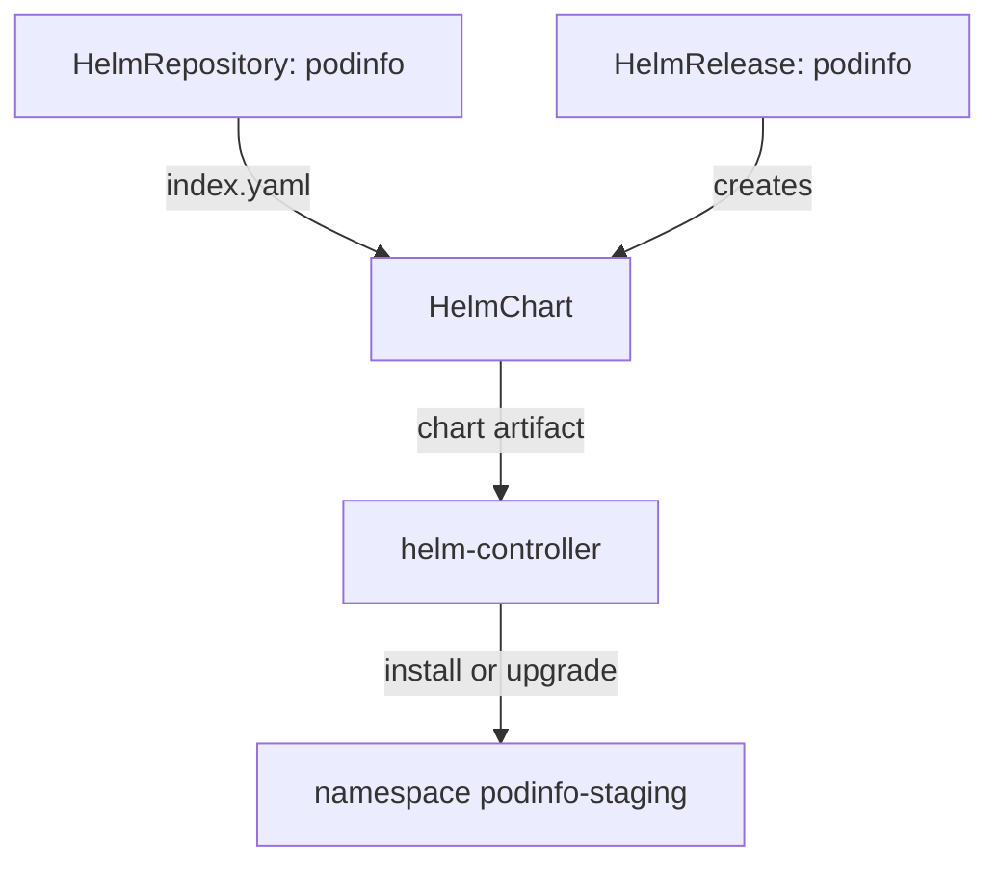

# From HelmRepository To HelmRelease

A Helm install with Flux involves three objects and two controllers, and most confusion about Helm in Flux comes from not knowing which one does what. This part installs the podinfo chart into staging and then reads the result from every side: the source, the chart, the release and Helm's own storage.

## Three objects, two controllers

The chart does not come from Git here. It comes from a **chart repository**: an HTTP server with an `index.yaml` file that lists every chart and version, and the chart packages next to it. Flux reads it through three objects:

| Object | Controller | What it does |
| --- | --- | --- |
| `HelmRepository` | source-controller | Points at a chart repository and downloads its index every `interval` |
| `HelmChart` | source-controller | Holds one chart at one version, downloaded from the repository and stored as an artifact |
| `HelmRelease` | helm-controller | Names the chart and the values, and installs or upgrades the release |

You create the `HelmRepository` and the `HelmRelease`. helm-controller creates the `HelmChart` for you from the field `spec.chart` of the `HelmRelease`, in the namespace of the `HelmRepository`.



The diagram shows the split: source-controller fetches the index and the chart, and helm-controller turns the chart and the values into a release.

## Add the chart repository

<!-- astrona:playground:renew -->

Save this as `helmrepository-podinfo.yaml`:

```yaml
apiVersion: source.toolkit.fluxcd.io/v1
kind: HelmRepository
metadata:
  name: podinfo
  namespace: flux-system
spec:
  interval: 1h
  url: https://stefanprodan.github.io/podinfo
```

Apply it:

```sh
kubectl apply -f helmrepository-podinfo.yaml
```

Then check the result:

```sh
flux get sources helm
```

The row for `podinfo` shows `READY` as `True`, and its revision is a digest of the downloaded index. If it stays not ready, the cluster cannot reach the internet. One `HelmRepository` can serve many releases in many namespaces, which is why it lives in `flux-system`.

## Install the chart into staging

The `HelmRelease` lives in the namespace of the application. It names the chart, an exact version, the repository, and a few values. Save this as `helmrelease-podinfo-staging.yaml`:

```yaml
apiVersion: helm.toolkit.fluxcd.io/v2
kind: HelmRelease
metadata:
  name: podinfo
  namespace: podinfo-staging
spec:
  interval: 10m
  releaseName: podinfo
  chart:
    spec:
      chart: podinfo
      version: 6.15.0
      sourceRef:
        kind: HelmRepository
        name: podinfo
        namespace: flux-system
  values:
    replicaCount: 1
    ui:
      message: staging
```

Apply it:

```sh
kubectl apply -f helmrelease-podinfo-staging.yaml
```

Then check the result:

```sh
flux get helmreleases -n podinfo-staging
kubectl -n gitea exec deploy/tester -- sh -c 'curl -s http://podinfo.podinfo-staging:9898 | jq -r .message'
```

The release shows `READY` as `True`, and podinfo answers with the message `staging`. `releaseName` sets the name of the Helm release, and with it the name of the Service, `podinfo`. Without it, helm-controller derives a name from the `HelmRelease`, which is easy to get wrong when you look for the Service later.

## Read the release from every side

The release now exists in four places, and each one answers a different question. The `HelmChart` shows which chart source-controller fetched:

```sh
flux get sources chart -A
```

There is one `HelmChart` in `flux-system`, named after the namespace and the name of the `HelmRelease`, with the chart version `6.15.0` as its revision. If a chart version does not exist, this is where the error shows, not on the release.

The `HelmRelease` status keeps a short history of the releases helm-controller made:

```sh
kubectl -n podinfo-staging get helmrelease podinfo \
  -o jsonpath='{range .status.history[*]}{.version}{" "}{.status}{" "}{.chartVersion}{"\n"}{end}'
```

The history has one entry: revision `1`, status `deployed`, chart version `6.15.0`. And Helm itself stores every revision as a Secret in the release namespace:

```sh
kubectl -n podinfo-staging get secrets -l owner=helm --show-labels
```

There is one Secret, `sh.helm.release.v1.podinfo.v1`, with the labels `name=podinfo`, `status=deployed` and `version=1`. This is Helm's own record, the same one the `helm` command reads. Every upgrade adds a Secret, so it is the most reliable place to see what happened to a release.

You can now install a chart with Flux and read the release from the source, the chart, the `HelmRelease` and Helm's storage. The open question is the values: inline values in the `HelmRelease` work, but they mix configuration with the object that installs it.

## Common pitfalls

> [!WARNING]
> - **A `sourceRef` without `namespace`.** helm-controller then looks for the `HelmRepository` in the namespace of the `HelmRelease` and does not find it.
> - **Looking for a chart error on the release.** A missing chart version shows on the `HelmChart` first. Run `flux get sources chart -A`.
> - **Leaving out `releaseName`.** The release, and the Service the chart creates, then get a derived name that is easy to get wrong.
> - **A version range in production.** `version: 6.x` installs whatever is newest at the next fetch. Pin an exact version and change it in a commit.
