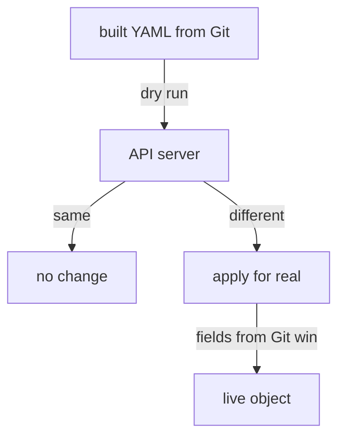

# Drift Correction With Server-Side Apply

A manual change during an incident is often the right call in the moment. The question is what happens to it afterwards. With a Flux `Kustomization`, the answer is decided on every reconciliation, by the same mechanism that applies Git in the first place: server-side apply. This part changes the staging Deployment by hand, watches kustomize-controller put it back, and then shows the exceptions you can make on purpose.

## How kustomize-controller finds drift

**Server-side apply** (SSA) is the Kubernetes API way to apply an object in which the API server records, for every field, which **field manager** set it. A field manager is a name such as `kubectl-edit` or the name of a controller. kustomize-controller applies every object with server-side apply, so the API server knows which fields came from Git.

On each reconciliation, kustomize-controller first runs a server-side apply **dry run**: the API server answers what the object would look like after the apply, without changing it. If that differs from the live object, the object has drifted, and kustomize-controller applies it for real. It also takes back the fields that came from Git when another manager changed them.



The diagram shows one reconciliation: a dry run first, and a real apply only when the result differs from the live object.

## Scale staging by hand

The staging Deployment has `replicas: 1` in Git. Change it by hand, the way someone would during an incident:

<!-- astrona:playground:renew -->

```sh
kubectl -n podinfo-staging scale deployment podinfo --replicas=4
kubectl -n podinfo-staging get deployment podinfo
```

The Deployment shows 4 replicas. Nothing in Flux has noticed yet: the next reconciliation is up to ten minutes away, the `interval` of `podinfo-staging`. Ask for it now:

```sh
flux reconcile kustomization podinfo-staging
kubectl -n podinfo-staging get deployment podinfo
```

The Deployment is back at 1 replica. kustomize-controller's dry run found that `replicas` differed from Git, and the real apply set it back. Without `flux reconcile`, the same thing would have happened within ten minutes. A manual change to a field that Git sets lasts at most one `interval`.

## Read who manages which field

The live object records its field managers in `metadata.managedFields`. `kubectl` hides them by default; show the managers and their operations:

```sh
kubectl -n podinfo-staging get deployment podinfo --show-managed-fields \
  -o jsonpath='{range .metadata.managedFields[*]}{.manager}{"  "}{.operation}{"\n"}{end}'
```

One manager is kustomize-controller, with the operation `Apply`: those are the fields from Git. Others, such as `kube-controller-manager` with `Update`, are Kubernetes controllers writing the object's status. This list is how kustomize-controller knows which fields belong to Git.

Fields that someone adds with `kubectl` are a special case. kustomize-controller removes them from the objects it manages too, so that a `kubectl edit` cannot leave extra fields behind. The documented way to keep a field you add by hand is to add it with the field manager `flux-client-side-apply`:

```sh
kubectl -n podinfo-staging label deployment podinfo oncall=alice --field-manager=flux-client-side-apply
flux reconcile kustomization podinfo-staging
kubectl -n podinfo-staging get deployment podinfo -L oncall
```

The label `oncall=alice` survives the reconciliation. Use this only for fields Git does not set; a field that Git sets is always taken back.

## Exceptions you can write in Git

Sometimes an object must not follow Git field by field. kustomize-controller reads an annotation on the object in Git, `kustomize.toolkit.fluxcd.io/ssa`, that changes how it applies that one object:

| Value | What kustomize-controller does |
| --- | --- |
| `Override` | The default. Applies the object and takes back drifted fields from Git |
| `Merge` | Applies the object but keeps fields that other managers added, as long as they do not overlap with Git |
| `IfNotPresent` | Creates the object if it does not exist, and never changes it after that |
| `Ignore` | Never applies the object at all |

Two more annotations go on objects in Git. `kustomize.toolkit.fluxcd.io/reconcile: disabled` makes kustomize-controller stop applying the object and stop pruning it, until the annotation is removed. `kustomize.toolkit.fluxcd.io/force: enabled` lets kustomize-controller delete and recreate the object when a change touches an immutable field, such as the selector of a Deployment; the field `spec.force: true` does the same for every object of a Flux `Kustomization`.

Every one of these is a hole in the guarantee that the cluster equals Git. `IfNotPresent` in particular is easy to forget: a later change to that object in Git never reaches the cluster, and nothing reports an error.

You can now predict what a reconciliation does to a manual change, read field managers, and choose an exception when one is really needed. The open question is the opposite case: an object that is still in the cluster after its file left Git.

## Common pitfalls

> [!WARNING]
> - **Fixing an incident with `kubectl` and leaving it there.** The fix lasts one `interval`. Commit it to Git.
> - **Expecting extra labels added with `kubectl` to stay.** kustomize-controller removes them unless they were added with the field manager `flux-client-side-apply`.
> - **`IfNotPresent` left on an object after the reason is gone.** Every later change to that object in Git is silently skipped.
> - **Using `force` as a habit.** It deletes and recreates objects, which restarts pods and can lose data in objects such as Jobs. Use it only for immutable fields.
